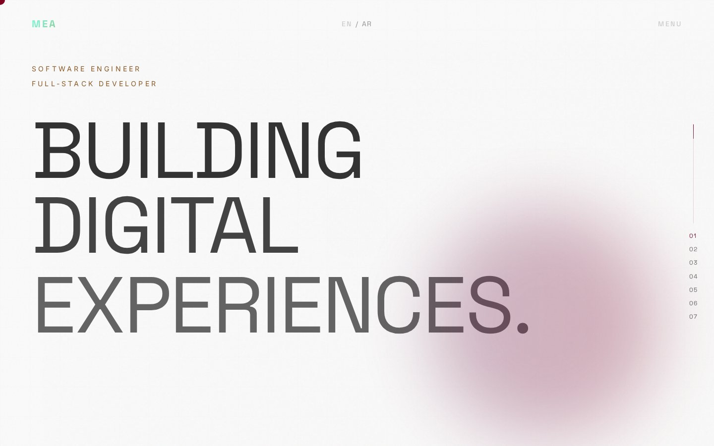
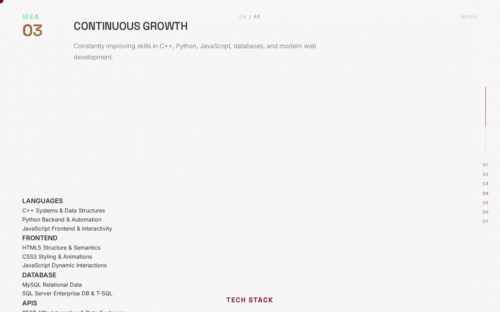
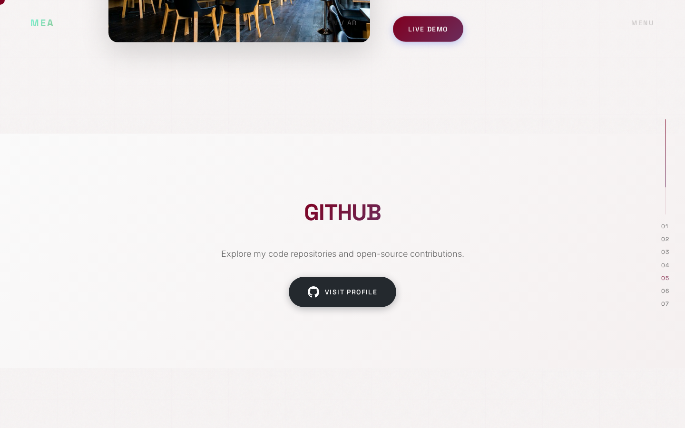
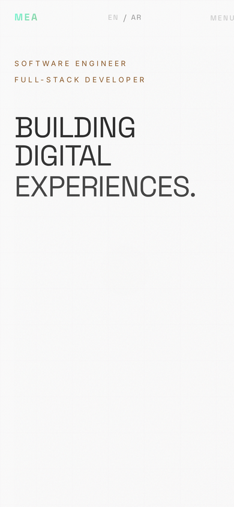

<h1 align="center">Mohammed Emad ALaini — Portfolio</h1>

<p align="center"><em>Personal portfolio of a Software Engineering student & Full-Stack Developer</em></p>

<p align="center">
  
  
  
  
</p>

<p align="center"><a href="https://mohammedemad.netlify.app/"><strong>🔗 Live Demo</strong></a></p>

<p align="center"></p>

## 📖 Overview

My personal portfolio website. It introduces who I am — a Software Engineering student at Superior University and a Full-Stack Developer — and showcases my selected work: web applications, software systems and real-world client websites for real estate and hospitality businesses.

## ✨ Features

- Bilingual interface with an **English / Arabic** language toggle
- Animated preloader, custom cursor and hover previews for projects
- Smooth scrolling and scroll-triggered animations (GSAP + ScrollTrigger + Lenis)
- Scroll progress indicator and full-screen navigation menu
- **Selected Work** section with 7 projects, each linking to its live demo
- About, journey timeline, expertise / tech stack and contact sections
- Contact form and direct contact details
- Fully responsive layout for desktop and mobile
- SEO meta tags, Open Graph and Twitter Card metadata

## 🛠️ Tech Stack

| Layer | Technology |
|---|---|
| Markup | HTML5 (semantic, accessible) |
| Styling | CSS3 (custom properties, responsive layout) |
| Logic | Vanilla JavaScript |
| Animation | GSAP 3, ScrollTrigger, Lenis smooth scroll |
| Fonts | Space Grotesk, Inter, Cairo, IBM Plex Sans Arabic (Google Fonts) |
| Hosting | Netlify |

## 📸 Screenshots

**Home**


**About**



**Projects**



**Mobile**



## 🌐 Live Demo

https://mohammedemad.netlify.app/

## 🚀 Getting Started

No build step needed — it's a static site.

```bash
git clone https://github.com/Mo-aini/mohammed-emad-portfolio.git
cd mohammed-emad-portfolio
```

Then open `index.html` in your browser, or serve the folder locally:

```bash
# Option 1: Python
python -m http.server 8000
# Option 2: Node
npx serve .
```

Visit `http://localhost:8000`. You can also use the **Live Server** extension in VS Code.


## 📁 Project Structure

```
mohammed-emad-portfolio/
├── screenshots/
│   ├── about.jpg
│   ├── home.jpg
│   ├── mobile.png
│   └── projects.png
├── .gitignore
├── favicon.svg
├── index.html
├── LICENSE
├── README.md
├── script.js
└── style.css
```

---

<div dir="rtl">

## 🇾🇪 بالعربي

موقعي الشخصي (البورتفوليو) — يعرّف بي كطالب هندسة برمجيات في جامعة Superior ومطوّر Full-Stack، ويعرض مشاريعي المختارة: تطبيقات ويب، أنظمة برمجية، ومواقع حقيقية لعملاء في مجال العقارات والضيافة.

**المميزات:** واجهة بلغتين (عربي / إنجليزي)، حركات وأنيميشن احترافية بـ GSAP، قسم للمشاريع مع روابط التجربة المباشرة، خط زمني لمسيرتي، المهارات والتقنيات، ونموذج تواصل. التصميم متجاوب مع الجوال.

**التشغيل:** افتح ملف `index.html` بالمتصفح مباشرة — لا يحتاج أي تثبيت.

**الرابط المباشر:** https://mohammedemad.netlify.app/

</div>

---

## 👤 Author

**Mohammed Emad ALaini** — Software Engineering student & Full-Stack Developer

- Portfolio: [mohammedemad.netlify.app](https://mohammedemad.netlify.app/)
- GitHub: [@Mo-aini](https://github.com/Mo-aini)
- LinkedIn: [Mohammed Emad](https://www.linkedin.com/in/mohammed-emad-24a841373)

## 📄 License

This project is licensed under the [MIT License](LICENSE).
